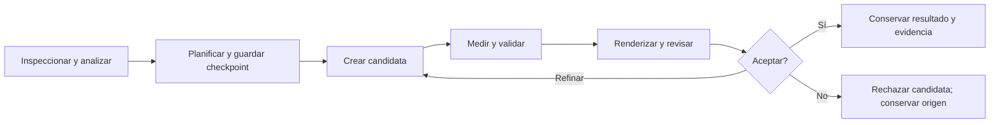

<div align="center">

# Blender Production MCP

### Inspecciona. Crea. Mide. Revisa. Conserva.

**Herramientas de producción para crear arte de videojuegos en Blender con ayuda de IA.**

[](LICENSE)
[](https://github.com/DiegoArias32/blender-production-mcp/releases)
[](docs/tool-catalog.md)
[](https://github.com/DiegoArias32/blender-production-mcp/actions/workflows/tests.yml)

[Instalación](docs/installation.md) · [Conecta tu asistente](docs/clients.md) · [Catálogo de herramientas](docs/tool-catalog.md) · [English](README.md)

</div>

Blender Production MCP permite que un asistente compatible con MCP trabaje con personajes, rigs, animaciones, mallas para videojuegos, expresiones faciales, movimiento secundario y materiales PBR mediante operaciones estructuradas. Conecta **Codex, Claude, Gemini CLI y otros clientes MCP locales** con Blender utilizando el addon y la comunicación de [mcp-for-blender](https://github.com/ahujasid/mcp-for-blender).

La idea es poder revisar cada resultado: inspeccionar el origen, guardar un checkpoint, crear una candidata separada, medirla, generar vistas comparables y evaluarla antes de aceptarla. El original sigue siendo la referencia.

> **Versión preliminar pública · v0.9.0.** La ejecución en Blender se ha validado en **Windows 11 + Blender 5.2.1 LTS**, con Python **3.11.16** para el servidor MCP. Otras versiones de Blender y otros sistemas operativos requieren validación. Los ejemplos de configuración se contrastaron con documentación oficial; eso no significa que todos los clientes se hayan probado de extremo a extremo. Consulta la [validación y sus límites](docs/validation.md).

## Qué puedes hacer

| Área | Herramientas prácticas |
|---|---|
| **Seguridad de escenas** | Auditorías, checkpoints, restauración en una copia de trabajo nueva, comparación de escenas, roles de assets y estado de operaciones. |
| **Inspección de rigs** | Armatures, propuestas de identificación con nivel de confianza, compatibilidad IK/FK, ajuste de controles compatible con constraints y revisión de deformaciones. |
| **Análisis y corrección de animación** | Contactos, deslizamiento de pies en unidades reales, continuidad de quaternions, limpieza de F-Curves, retiming, root motion y vistas antes/después. |
| **Mocap** | Análisis de esqueletos, mappings revisados y retargeting mediante los adaptadores compatibles. |
| **Edición de personajes** | Regiones protegidas, candidatas que conservan la topología, protección de shape keys y revisión de deformaciones. |
| **Preparación para videojuegos** | Presupuestos de geometría, reducción guiada de polígonos, transferencia de atributos y pesos, validación UV/UDIM, cages y preparación para bake. |
| **Animación corporal y facial** | Briefs estructurados, blocking, generación para bípedos compatibles, expresiones, mirada, parpadeos y sincronización labial con tiempos explícitos. |
| **Movimiento secundario** | Candidatas de resortes, tela y pelo compatible, con validación de cachés, bake y evaluación temporal. |
| **Materiales y PBR** | Inspección de nodos y texturas, revisión de canales y espacios de color, shaders candidatos aislados, perfiles de materiales y comparación bajo iluminación controlada. |

Cada flujo tiene límites de compatibilidad explícitos. Un rig desconocido, una propuesta desactualizada o una simulación no compatible producen un informe o un rechazo. **Superar una prueba técnica y aprobar el resultado visual son decisiones distintas.**

## Un proceso que puedes revisar



Las operaciones devuelven datos estructurados: nombres e identificadores pertinentes, advertencias, errores, métricas, identificadores de operación y referencias a checkpoints. La geometría pesada permanece en Blender; el asistente recibe resúmenes y el detalle necesario.

## Empieza en pocos pasos

Necesitas **Blender, Git, uv y un cliente MCP local**. Recomendamos Python 3.11; uv puede instalarlo por separado del Python que utiliza Blender.

```sh
git clone https://github.com/DiegoArias32/blender-production-mcp.git
cd blender-production-mcp
git checkout v0.9.0
uv sync --frozen --python 3.11
```

Instala el **addon incluido en esta versión** y habilita **MCP for Blender** en las preferencias de complementos de Blender:

```sh
uv run --frozen mcp-for-blender addon-paths
uv run --frozen mcp-for-blender install-addon
```

El instalador muestra la ruta de destino e intenta crear un respaldo `.bak`. Guarda tu propia copia antes de reemplazar una instalación: un fallo del respaldo no detiene el instalador upstream. En Blender, abre la barra lateral de la vista 3D: **N → MCP for Blender → Start MCP Server**. Mantén el addon en **localhost:9876** y su telemetría desactivada.

Elige el cliente que vas a utilizar:

| Cliente | Configuración |
|---|---|
| **Codex** | [Registro por terminal y `config.toml`](docs/clients.md#codex) |
| **Claude Desktop** | [Configuración de la aplicación](docs/clients.md#claude-desktop) |
| **Claude Code** | [Registro por terminal](docs/clients.md#claude-code) |
| **Gemini CLI** | [Registro por terminal y archivo de ajustes](docs/clients.md#gemini-cli) |
| **Cursor** | [Configuración MCP](docs/clients.md#cursor) |
| **VS Code / GitHub Copilot** | [Configuración MCP](docs/clients.md#vs-code--github-copilot) |

Todos arrancan **`blender-production` por stdio**. El puerto `9876` pertenece al socket del addon de Blender; no es una dirección HTTP de MCP. Utiliza un solo cliente/controlador a la vez por instancia de Blender.

**¿Es tu primer MCP?** La [guía de instalación](docs/installation.md) explica cómo instalar uv, configurar rutas de Windows, verificar la conexión, actualizar y resolver problemas. Esta entrega no publica el fork en PyPI: instálalo desde este repositorio.

## Prueba estas peticiones

Empieza en una escena desechable o en una copia de trabajo creada para la tarea.

> Audita esta escena. Informa la versión de Blender, los objetos, armatures, unidades, FPS y rango de animación. No modifiques nada.

> Analiza este ciclo de caminata. Identifica posibles controles de pie, explica cómo estimas los contactos, mide el deslizamiento en centímetros e indica los frames problemáticos. Propón las correcciones antes de aplicarlas.

> Inspecciona los materiales de este personaje, sus dependencias de texturas, espacios de color y compatibilidad UV/UDIM. Guarda un checkpoint antes de crear una candidata de material separada y genera renders con la misma iluminación para compararlos.

> Planifica una animación de ataque para este rig. Primero inspecciona sus controles y compatibilidad IK/FK. Trabaja en una Action separada: blocking, timing y evaluación de contactos, root motion y previews temporales antes de aceptarla.

El agente debe pedir la intención o las decisiones de mapping que falten cuando afecten a la seguridad o a la calidad. No debe deducir anatomía únicamente por nombres de huesos ni afirmar que un render se ve bien sin inspeccionarlo.

## La seguridad forma parte del trabajo

- **Trabaja en copias.** Los assets MASTER están protegidos; registra una copia de trabajo o una fixture controlada antes de modificarlos.
- **Guarda un checkpoint antes de cambios estructurales.** Conserva el origen, la intención, la fecha y los hashes de integridad.
- **Planifica antes de aplicar.** Comprueba que las propuestas siguen correspondiendo al estado de la escena; rechaza evidencia desactualizada.
- **Mantén la conexión local.** Production exige safe mode y desactiva la telemetría del servidor upstream. El socket del addon no tiene autenticación y debe permanecer en loopback.
- **Conserva la evidencia.** Si una operación agota el tiempo de espera, revisa su estado y Blender antes de repetir una modificación.
- **Evalúa visualmente.** Las métricas no certifican anatomía, interpretación, realismo ni calidad artística.

El validador de safe mode es una protección adicional, no una sandbox del sistema operativo. Tu cliente de IA tiene sus propias políticas de tratamiento de datos. Consulta [seguridad](docs/security.md) y [privacidad](PRIVACY.md).

## Una base que se puede mantener

```text
Tu cliente MCP
  └─ stdio → blender_mcp.production.server
       └─ production/{animation,rig,character,game_mesh,generation,facial,physics,materials,…}
            └─ common: protecciones, registro de operaciones, checkpoints, almacenamiento, bridge
                 └─ BlenderConnection upstream → socket localhost → addon de Blender → bpy
```

Las herramientas de producción están organizadas en módulos por área. El addon, la conexión socket y el validador de safe mode del proyecto original siguen siendo identificables. El commit upstream de partida y el procedimiento de actualización están documentados en [NOTICE](NOTICE.md) y [sincronización upstream](docs/upstream-sync.md).

## Documentación

| Para empezar | Para profundizar |
|---|---|
| [Instalación](docs/installation.md) | [Arquitectura](docs/architecture.md) |
| [Clientes y configuraciones copiables](docs/clients.md) | [Catálogo completo de herramientas](docs/tool-catalog.md) |
| [Validación y límites conocidos](docs/validation.md) | [Flujo de animación](docs/animation-workflow.md) |
| [Cómo contribuir](CONTRIBUTING.md) | [Compatibilidad de rigs](docs/rig-compatibility.md) |
| [Reportar problemas de seguridad](SECURITY.md) | [Evaluación de materiales](docs/material-qa.md) |

Muchos documentos técnicos por área están en español. Las guías de instalación y clientes están en inglés, con comandos y ejemplos completos. También puedes consultar el [README en inglés](README.md).

## Desarrollo

```sh
uv sync --frozen --python 3.11 --group dev
uv run --frozen pytest -q
uv run --frozen python scripts/verify_install.py
```

La comprobación de instalación realiza una conexión MCP real y lista las herramientas sin conectarse a Blender. Las pruebas específicas de Blender están en `tests/blender/`: ejecútalas expresamente sobre fixtures desechables. Lee [CONTRIBUTING](CONTRIBUTING.md) antes de proponer cambios de integración.

## Licencia y créditos

**Licencia MIT.** Puedes usar, modificar y redistribuir el código, también comercialmente, conforme a [LICENSE](LICENSE). Conserva la licencia y la atribución.

Blender Production MCP es mantenido por [DiegoArias32](https://github.com/DiegoArias32) y deriva de **[mcp-for-blender, de Siddharth Ahuja](https://github.com/ahujasid/mcp-for-blender)**. La licencia MIT original se conserva sin cambios. Este es un proyecto comunitario independiente; no es un producto oficial de Blender, OpenAI, Anthropic ni Google. Blender y tu cliente de IA son productos separados y tienen sus propias condiciones.
