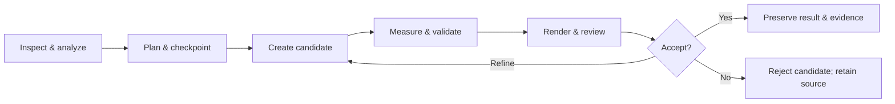

<div align="center">

# Blender Production MCP

### Inspect. Create. Measure. Review. Preserve.

**A production workflow layer for AI-assisted game art in Blender.**

[](LICENSE)
[](https://github.com/DiegoArias32/blender-production-mcp/releases)
[](docs/tool-catalog.md)
[](https://github.com/DiegoArias32/blender-production-mcp/actions/workflows/tests.yml)

[Get started](docs/installation.md) · [Connect your AI client](docs/clients.md) · [Tool catalog](docs/tool-catalog.md) · [Español](README.es.md)

</div>

Blender Production MCP gives an MCP-capable assistant structured workflows for characters, rigs, animation, game meshes, facial performance, secondary motion and PBR materials. It connects **Codex, Claude, Gemini CLI and other local MCP clients** to Blender through the established [mcp-for-blender](https://github.com/ahujasid/mcp-for-blender) addon and transport.

The focus is repeatable work: inspect the source, create a checkpoint, build a separate candidate, measure the result, render comparable previews, and review before acceptance. Your original remains the reference.

> **Public preview · v0.9.0.** Blender execution has been qualified on **Windows 11 + Blender 5.2.1 LTS**, with Python **3.11.16** for the MCP server. Other Blender versions and operating systems require validation. Client setup examples are checked against official documentation; this does not mean every client has been tested end to end. See [validation and limitations](docs/validation.md).

## What you can do

| Workflow | Practical capabilities |
|---|---|
| **Scene safety** | Audits, checkpoints, restore into a new working copy, scene differences, asset roles and operation status. |
| **Rig inspection** | Armatures, semantic candidates with confidence, IK/FK compatibility, constrained matching and deformation checks. |
| **Animation QA & correction** | Contacts, foot sliding in real units, quaternion continuity, F-Curve cleanup, retiming, root motion and before/after previews. |
| **Mocap** | Skeleton analysis, reviewed mappings and retargeting through supported adapters. |
| **Character editing** | Protected regions, topology-preserving candidate edits, shape-key safeguards and deformation review. |
| **Game mesh preparation** | Budgets, guided decimation, attribute/weight transfer, UV/UDIM validation, cages and bake readiness. |
| **Body & facial animation** | Structured briefs, blocking, supported biped generation, expressions, gaze, blinks and lip-sync from explicit timing. |
| **Secondary motion** | Candidate-based spring, cloth and supported hair workflows with cache/bake validation and temporal QA. |
| **Materials & PBR** | Node/texture inspection, channel and color-space checks, isolated shader candidates, material profiles and controlled lighting comparisons. |

These workflows have explicit compatibility limits. An unknown rig, stale proposal or unsupported simulation produces a report or rejection. **A technical pass is separate from visual approval.**

## A workflow you can review



Operations return structured findings with relevant names/IDs, warnings, errors, metrics, operation IDs and checkpoint references. Large geometry stays in Blender; the assistant receives summaries and selected detail.

## Start in a few steps

You need **Blender, Git, uv, and one local MCP client**. Python 3.11 is recommended; uv can install it separately from Blender's own Python.

```sh
git clone https://github.com/DiegoArias32/blender-production-mcp.git
cd blender-production-mcp
git checkout v0.9.0
uv sync --frozen --python 3.11
```

Install the **matching bundled addon**, then enable **MCP for Blender** in Blender's Add-ons preferences:

```sh
uv run --frozen mcp-for-blender addon-paths
uv run --frozen mcp-for-blender install-addon
```

The installer prints its destination and attempts a `.bak` backup. Make your own backup before replacing an existing addon. Review an existing installation before changing it. In Blender, open the 3D View sidebar with **N → MCP for Blender → Start MCP Server**. Keep the addon on **localhost:9876**, and leave addon telemetry disabled.

Then choose your client:

| Client | Setup |
|---|---|
| **Codex** | [CLI registration and `config.toml`](docs/clients.md#codex) |
| **Claude Desktop** | [Desktop configuration](docs/clients.md#claude-desktop) |
| **Claude Code** | [CLI registration](docs/clients.md#claude-code) |
| **Gemini CLI** | [CLI registration and settings](docs/clients.md#gemini-cli) |
| **Cursor** | [MCP configuration](docs/clients.md#cursor) |
| **VS Code / GitHub Copilot** | [MCP configuration](docs/clients.md#vs-code--github-copilot) |

All clients launch **`blender-production` over stdio**. Port `9876` belongs to the Blender addon socket; it is not an HTTP MCP endpoint. Only one client/controller may use a Blender instance at a time.

**New to MCP?** The [installation guide](docs/installation.md) includes uv installation, Windows paths, verification, updates and troubleshooting. There is no PyPI release of this fork in this delivery; install from this repository.

## Try these requests

Start in a disposable scene or a deliberately created working copy.

> Audit this scene. Report the Blender version, objects, armatures, units, FPS and animation range. Do not modify anything.

> Analyze this walk cycle. Identify possible foot controls, explain contact assumptions, measure sliding in centimeters and report problematic frames. Propose corrections before applying them.

> Inspect this character's material setup, texture dependencies, color spaces and UV/UDIM compatibility. Create a separate material candidate only after a checkpoint, then render matched lighting comparisons for review.

> Plan an attack animation for this rig. First inspect its controls and IK/FK compatibility. Use a separate Action, work through blocking and timing, then evaluate contacts, root motion and temporal previews before acceptance.

The agent should ask for missing intent or mapping decisions when those affect safety or quality. It must not invent anatomy from bone names or claim a render looks good without inspecting it.

## Safety is part of the workflow

- **Work on copies.** MASTER assets are protected; register a working copy or controlled fixture before mutation.
- **Checkpoint before structural changes.** Keep the source, intent, timestamp and integrity hashes.
- **Plan before applying.** Revalidate proposals against current scene state; reject stale evidence.
- **Keep it local.** Production enforces safe mode and disables upstream server telemetry. The addon socket is unauthenticated and must stay on loopback.
- **Keep evidence.** After an uncertain timeout, inspect operation status and Blender before retrying a mutation.
- **Review visually.** Numerical QA does not certify anatomy, performance, realism or artistic quality.

The safe-mode validator is a guardrail, not an operating-system sandbox. Your AI client has its own data handling policies. Read [security](docs/security.md) and [privacy](PRIVACY.md).

## Built on a maintained foundation

```text
Your MCP client
  └─ stdio → blender_mcp.production.server
       └─ production/{animation,rig,character,game_mesh,generation,facial,physics,materials,…}
            └─ common: guards, ledger, checkpoints, storage, bridge
                 └─ upstream BlenderConnection → localhost socket → Blender addon → bpy
```

Production capabilities live in domain modules. The upstream addon, socket connection and safe-mode validator remain identifiable. The exact starting upstream commit and the update process are recorded in [NOTICE](NOTICE.md) and [upstream sync](docs/upstream-sync.md).

## Documentation

| Start here | Go deeper |
|---|---|
| [Installation](docs/installation.md) | [Architecture](docs/architecture.md) |
| [Client setup + copyable configs](docs/clients.md) | [Complete tool catalog](docs/tool-catalog.md) |
| [Validation and known limits](docs/validation.md) | [Animation workflow](docs/animation-workflow.md) |
| [Contributing](CONTRIBUTING.md) | [Rig compatibility](docs/rig-compatibility.md) |
| [Security reporting](SECURITY.md) | [Material QA](docs/material-qa.md) |

Most detailed domain documents currently use Spanish; the installation and client guides are in English, with a [Spanish overview](README.es.md).

## Development

```sh
uv sync --frozen --python 3.11 --group dev
uv run --frozen pytest -q
uv run --frozen python scripts/verify_install.py
```

The install check performs a real MCP handshake and lists tools without connecting to Blender. Blender probes live under `tests/blender/`; run them explicitly against disposable fixtures. See [CONTRIBUTING](CONTRIBUTING.md) before contributing integration changes.

## License & credits

**MIT licensed.** Use, modify and redistribute the code, including commercially, under the terms of [LICENSE](LICENSE). Preserve the license and attribution.

Blender Production MCP is maintained by [DiegoArias32](https://github.com/DiegoArias32), and derives from **[mcp-for-blender by Siddharth Ahuja](https://github.com/ahujasid/mcp-for-blender)**. The original MIT license is retained unchanged. This is an independent community project, not an official Blender, OpenAI, Anthropic or Google product. Blender and your AI client are separate products with their own terms.
